# PRISM end-to-end architecture

```mermaid
flowchart LR
    A[Four CSV inputs] --> B[Azure Storage: prism-history]
    B --> C[Azure ML training job]
    C --> D[Registered 2-model asset]
    D --> E[Azure ML managed endpoint]
    A --> F[Python CSV event replay]
    F --> G[Azure Event Hubs]
    G --> H[Azure Function: ingest]
    H --> I[Azure Storage Queue]
    I --> J[Azure Function: infer and orchestrate]
    J --> E
    E --> K[Predicted runtime or remaining runtime]
    K --> L[Foundry Monitoring agent]
    L --> M[Diagnostics agent]
    M --> N[Sizing agent]
    N --> O[Cost agent]
    O --> P[Remediation agent]
    P --> Q[Communication agent]
    Q --> R[Blob JSON prediction results]
    R --> S[Streamlit Container App]
    S --> T[Human review records]
    J --> U[Application Insights]
    U --> V[Azure Monitor + Action Group]
```

### Behavioral contract

- The edge `E -> K -> L` is the core user requirement: **a real trained model prediction is incorporated into subsequent AI agent reasoning**. The agent output is passed serially through six specialist agents.
- Event Hub is a transport, not a permanent long-term datastore. Queue provides an inference retry boundary; Blob stores results, while Application Insights stores operational logs.
- The Azure Function role `RunPrismInference` never invokes a Databricks write API. Manual approval records a review, not execution.
- All provided CSVs are historical. Live Databricks telemetry and workload configuration changes are **out of scope until an actual Databricks workspace and permissions are provided**.
- Azure AI Foundry managed prompt-agent APIs require a current Foundry project and Azure AI Projects Python SDK 2.3 or later. The resource is not provisioned simply by setting an environment variable.
- Streamlit handles operator presentation rather than Power BI, which is mocked/absent in this design.
